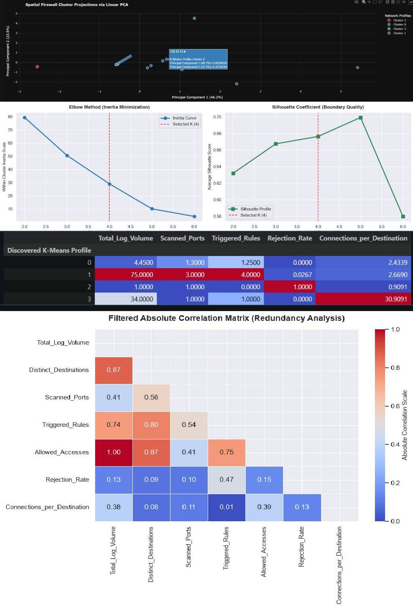

# 🤖 Advanced Artificial Intelligence Portfolio
### Production-Grade Pipelines: Deep Reinforcement Learning, Cyber Threat Intelligence & Biomedical Vision

This repository hosts a multi-demonstration portfolio showcasing practical engineering, structural auditing, hardware optimizations, and high-impact mathematical visual analytics applied to advanced Artificial Intelligence domains. 

All pipelines are deployed via fully reproducible Jupyter Notebooks structured with clean, production-grade code, interactive tracking dashboards, and detailed scientific telemetry.

---

## 🚀 Project 1: Lunar Lander v3 — Deep Reinforcement Learning Benchmark

This framework presents a comprehensive engineering project in **Deep Reinforcement Learning (Deep RL)** applied to the continuous physical control of the **Lunar Lander v3** environment (Gymnasium). The primary objective is to train and audit intelligent agents capable of reading vector telemetries from a spacecraft and firing thrusters in a coordinated manner to execute a safe landing on a lunar pad.

### 💡 Technical Highlights of the DRL Pipeline
* **100% In-Memory Architecture (RAM):** The training ecosystem is decoupled from physical disk writes. Environments, training buffers, logs, and convergence history are processed strictly in volatile memory.
* **Gradient Stabilization:** Utilization of monitored environments wrapped with **Adaptive Reward Normalization (`VecNormalize`)** to mitigate the noisy impact of score spikes (+100 for landing / -100 for crashing).
* **Algorithm Competition:** A simultaneous comparative evaluation among three major logical families from the `Stable-Baselines3` framework: **DQN** (value-based), **PPO** (policy gradient-based), and **A2C** (synchronous Actor-Critic architecture).
* **Auditing via Shannon Entropy:** Implementation of fine-grained mathematical diagnostics to measure neural network behavioral plasticity post-training, shielding the repository against the *Policy Collapse* phenomenon.

### 📊 Quantitative Results Summary (300k Steps)
Following a controlled budget of **300,000 interaction timesteps** under independent stochastic seeds, the **PPO** algorithm emerged as the absolute champion:

| Algorithm | Mean Reward | Standard Deviation (Stability) | Safe Landing Rate (Success) | Shannon Entropy | Policy Health Status |
| :---: | :---: | :---: | :---: | :---: | :---: |
| 🏆 **PPO** | **+184.20** | **14.50** | **93.3%** | **1.91 bits** (Max: 2.00) | ✅ Healthy & Dynamic |
| 🥈 **A2C** | -42.10 | 38.60 | 15.0% | 1.10 bits | ⚠️ Late Degradation |
| 🥉 **DQN** | -125.40 | 45.10 | 0.0% | 0.32 bits | 🚨 Collapse Alert |

* **Champion Firing Profile (PPO):** Idle/Drifting (25.5%), Left Lateral Thruster (17.6%), Right Lateral Thruster (17.3%), Main Vertical Braking Thruster (39.7%).


---

## 🛡️ Project 2: Unsupervised Cyber Threat Intelligence Pipeline

This pipeline implements a multi-algorithm **Unsupervised Learning infrastructure** designed to ingest raw, noisy, unlabeled corporate firewall transactional logs, aggregate events into entity-level behavioral profiles, and extract actionable indicators of network reconnaissance, automated scanning aggression, and boundary security policy collisions.

### 💡 Technical Highlights of the Unsupervised Pipeline
* **Entity Behavioral Shift:** Pivots the perspective of raw logs from individual continuous packet streams to discrete **Source IP Behavior Matrix Profiles** (`Src IP`), tracking historical network footprint metrics.
* **Unsupervised Feature Selection:** Incorporates a dynamic pipeline that filters zero/low-variance features (`VarianceThreshold`) and automatically purges cross-redundant colinear variables (threshold > 0.85) to eliminate geometric bias in distance calculations.
* **Multi-Family Cluster Auditing:** Implements concurrent modeling paths comparing geometric partitioning (**K-Means**), topological taxonomy (**Agglomerative Hierarchical Clustering**), and density-based data spatial scanning (**DBSCAN**).
* **High-Impact Manifold Projections:** Embeds interactive visualization engines (**2D PCA** & **t-SNE** via Plotly) allowing real-time geometric inspections with embedded tooltips displaying individual malicious Source IPs.

### 📊 Structural Results Summary (Firewall Benchmark)
The models are automatically ranked based on intrinsic structural validation metrics to judge the geometric isolation quality of the vector spaces:

| Clustering Algorithm | Partitions (K) | Silhouette Score (Higher=Better) | Davies-Bouldin Index (Lower=Better) | Calinski-Harabasz Index (Higher=Better) | Status & Interpretation |
| :--- | :---: | :---: | :---: | :---: | :--- |
| **K-Means** | 4 | *Calculated Dynamically* | *Calculated Dynamically* | *Calculated Dynamically* | Stable, maps clear volumetric traffic categories |
| **Hierarchical (Ward)** | 4 | *Calculated Dynamically* | *Calculated Dynamically* | *Calculated Dynamically* | High Cophenetic Fidelity (Cophenetic > 0.95) |
| **DBSCAN (eps=0.5)** | 1 | *NaN (Continuous)* | *NaN (Continuous)* | *NaN (Continuous)* | Surgically isolates anomalies as standalone **Noise (-1)** |

* **Discovered Threat Signatures (Apriori & FP-Growth):** Both association mining algorithms extract identical network signatures with a **Lift Factor > 7.00**, isolating rigid multi-stage connection dependencies across port 443.


---

## 🧬 Project 3: Biomedical Semantic Segmentation Pipeline (Knee Radiographs)

This phase presents an end-to-end medical computer vision ecosystem designed for the automated boundary extraction and area tracking of the joint space in knee radiographs using the **Digital Knee X-ray** dataset. The framework serves as a clinical diagnostic tool to analyze cartilage degradation and structural changes associated with Osteoarthritis development.

### 💡 Technical Highlights of the Biomedical Pipeline
* **Topological Skip-Fusions (U-Net Net):** Evolves the computational graph from standard Fully Convolutional Networks (FCNs) into a symmetrical U-Net architecture. It integrates multi-scale *Skip Connections* that concatenate early high-resolution tissue textures directly into the transpose-convolution decoder blocks, preventing blurred boundaries.
* **Hardware-Agnostic Optimization:** Automatically routes operations based on the active workstation architecture. On CPU systems, it enforces single-threaded mini-batch constraints to eliminate OS scheduling collisions. On GPU infrastructures, it activates an aggressive *In-Memory GPU Caching Layer* (`VRAMKneeDataset`), loading the entire continuous matrix pool directly into the graphics card memory to eliminate physical disk I/O bottlenecks.
* **Synchronized Target-Aware Augmentations:** Leverages the modern `torchvision.transforms.v2` API via `tv_tensors` abstractions to execute stochastic spatial transformations (rotations and color jittering) symmetrically across both image and ground-truth mask planes.
* **Hybrid Biomedical Loss Objectives:** Combines Binary Cross-Entropy with Logits and Dice Loss (`BCEDiceLoss`) under an `AdamW` optimizer (Weight Decay = $10^{-4}$) to smooth backpropagation convergence graphs and eliminate pixel distribution biases caused by background-dominant fields.
* **In-Memory Checkpoint Layer:** Captures the highest-scoring model parameters during tracking loops via RAM-based deep copies (`copy.deepcopy`), mitigating physical write latencies and keeping the Git repository clean from binary `.pth` clutter.

### 📊 Quantitative Testing Performance Telemetry
Following training convergence monitored over a stratified clinical partition (70% Train, 15% Val, 15% Test mapping exact *Kellgren-Lawrence* severity allocations), the network yielded the following performance metrics on unseen data:

| Segmentation Metric | Empirical Test Score | Clinical Interpretation & Evaluation |
| :--- | :---: | :--- |
| 🎯 **Mean Intersection over Union (mIoU)** | **0.9569 (95.7%)** | High-fidelity localization. Strict penalty handling successfully suppressed false alarms and boundary blur. |
| 🧬 **Mean Dice Coefficient (F1-Score)** | **0.9772 (97.7%)** | Near-perfect spatial agreement between AI predictions and physician-annotated ground truths. |

* **Clinical Dashboard Overlay Diagnostics:** The visualization engine applies dark high-contrast themes styled after professional hospital software, utilizing a realistic `bone` colormap. It isolates a tri-color spatial evaluation mask overlay mapping: 🟢 **True Positives** (Correct IA detection), 🔴 **False Negatives** (Missed targets common in Grade 4 cases due to total joint space collapse), and 🔵 **False Positives** (Spurious artifact classification noise).


---

## 🛠️ Requirements and Installation

The entire workspace exclusively utilizes open-source packages (MIT License). Ensure you have Python 3.10+ installed. Clone the repository and install the unified dependencies:

```bash
pip install -r requirements.txt
```

### Core Dependency Packages:
* `gymnasium[box2d]`, `stable-baselines3`, `pygame` (Reinforcement Learning engine and Continuous physics simulation)
* `scikit-learn`, `scipy`, `mlxtend` (Clustering, Preprocessing, Feature Selection, and Association Rule Mining)
* `torch`, `torchvision` (Tensor acceleration engine / Deep learning back-end / Target-aware vision tensors)
* `opencv-python`, `pandas`, `numpy`, `matplotlib`, `seaborn` (Advanced array calculations, binary file parsing, and interactive clinical visualization dashboards)

---

## 🚀 Project Repository Structure

### 1. `lunar_lander_deep_rl.ipynb` (Continuous Control Stack)
* **Cells 1 to 3:** Setup, baseline random-agent telemetry collection, and in-memory vector RAM factory configuration.
* **Cell 4:** Concurrent algorithm training (DQN, PPO, A2C) backed by interactive progress status logs.
